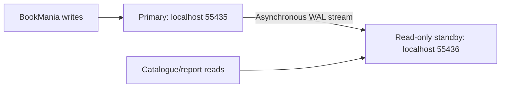

# Portfolio 5 - BookMania distributed database exercise

This activity demonstrates **PostgreSQL asynchronous streaming replication** using a writable primary and a read-only standby. It covers distributed setup, replication/consistency evidence and a short availability/cloud discussion. No sharded cluster, automatic failover or paid cloud account is needed.

**Status:** completed and student-reviewed, with nine selected screenshots, confirmed execution date, project context and reflection documented. Primary/standby roles, asynchronous streaming, matching records, rejected standby writes and unchanged stock are evidenced by the student's captures.

## Architecture



Both nodes run in Docker on this computer with separate named volumes. The primary is initialised with Portfolio 1's schema and synthetic data; the standby receives a physical base backup and then streams changes. These are new database instances named `bookmania`, not connections to your existing PostgreSQL installation. MongoDB and the earlier reviewed databases are not changed.

## Files

| File | Purpose |
|---|---|
| `compose.yaml` | Two PostgreSQL services, replication settings, health checks and volumes. |
| `primary-init.sh` | Create a password-authenticated replication role and allow replication connections. Runs automatically during initialisation. |
| `standby.sh` | Initialise an empty standby using pg_basebackup and start recovery. Restarts reuse its existing data; no data-directory deletion is performed. |
| `.env.example` | Empty password template; real values belong in ignored `.env`. |
| `01-primary-status.sql` | Identify primary and inspect streaming/asynchronous replication. |
| `02-primary-insert.sql` | Insert one synthetic book on primary and display it. |
| `03-standby-read.sql` | Confirm standby role/read-only mode, receiver state and replicated book. |
| `04-standby-write-test.sql` | Demonstrate rejection of an UPDATE on standby. |
| [Discussion](discussion.md) | Replication lag, consistency, availability, sharding and cloud deployment. |
| [Evidence index](evidence/README.md) | Student screenshot captions, run details and interpretation. |

The setup references Portfolio 1's two SQL files by relative path. Keep the repository structure intact. The root `.gitattributes` keeps shell scripts in LF format for Linux containers.

## Start your own run

Requires Docker Desktop with Linux containers, Docker Compose and pgAdmin. Open PowerShell in this folder. Ports **55435** and **55436** must be free; an existing PostgreSQL server on 5432 can remain running.

Create local credentials **once**, if `.env` does not already exist:

```powershell
if (-not (Test-Path -LiteralPath .env)) {
    $bookmaniaAdminPassword = [guid]::NewGuid().ToString('N')
    $bookmaniaReplicationPassword = [guid]::NewGuid().ToString('N')
    Set-Content -LiteralPath .env -Encoding ascii -Value @(
        "POSTGRES_PASSWORD=$bookmaniaAdminPassword",
        "REPLICATION_PASSWORD=$bookmaniaReplicationPassword"
    )
}
```

The ignored `.env` created during the agent test can be reused. Alternatively, copy `.env.example` to `.env` and fill in your own values before the first start. Do not change passwords in `.env` after volumes are initialised and expect stored database passwords to change automatically. Do not commit `.env` or capture its values in screenshots.

Start a **separate student project**, so the agent's already-inserted demo record is not reused:

```powershell
docker compose -p bookmania-p5-student up -d --wait --wait-timeout 120
docker compose -p bookmania-p5-student ps
```

Expect two healthy services. Initialisation runs once per new primary volume. This command may download the PostgreSQL image if it is unavailable locally.

## Connect in pgAdmin and demonstrate replication

Register two server connections:

| Setting | Primary | Standby |
|---|---|---|
| Host | 127.0.0.1 | 127.0.0.1 |
| Port | 55435 | 55436 |
| Maintenance database | bookmania | bookmania |
| Username | postgres | postgres |
| Password | Your POSTGRES_PASSWORD from local .env | Same password: roles were physically replicated |

Use clearly named Query Tool tabs and keep auto-commit enabled.

1. **Primary:** execute `01-primary-status.sql`. Expect `is_standby = false`, one replication row in `streaming` state and `sync_state = async`. If the connection row is not present immediately after startup, wait briefly and rerun this read-only script.
2. **Primary:** execute the entire `02-primary-insert.sql` once. Capture `BookMania Replication Demo`, ISBN `9789999500001`, price 2500 and stock 7. To inspect it again, rerun only the final SELECT.
3. **Standby:** execute `03-standby-read.sql`. Expect `is_standby = true`, `transaction_read_only = on`, receiver status `streaming` and the same book. Asynchronous replay may lag: rerun the final SELECT if needed. Book IDs and LSNs can vary by run.
4. **Standby:** execute `04-standby-write-test.sql`. The UPDATE must fail with **cannot execute UPDATE in a read-only transaction**, SQLSTATE **25006**. This error is expected. If the connection is left in an aborted transaction, execute `ROLLBACK;` there.
5. Rerun the standby book SELECT and primary status query. Confirm stock remains 7 and replication is still streaming. Capture the results for your evidence.

The UPDATE assigns the existing stock value to itself; it is still a prohibited write command on a standby. The script first checks the server role. Successful query execution is not the expected outcome of the write test.

## Stop and repeat

```powershell
docker compose -p bookmania-p5-student stop
```

Stopping retains the volumes. A later `up` resumes the same dataset, so do not repeat the insert if it already exists. For a completely new run, stop the old project and use a new project name consistently, such as `bookmania-p5-student-2`; this creates separate volumes. There is no need to delete your existing databases or volumes.

The agent project `bookmania-p5` was stopped after testing, retaining its own volumes. Do not start it at the same time as the student project because they use the same two host ports.

## Student review and AI use

### Execution evidence

My [nine selected screenshots](evidence/README.md) show PostgreSQL **17.10**, database **bookmania**, primary `is_standby = false`, standby `is_standby = true` and read-only mode `on`. The primary reports a streaming/asynchronous replication connection. Both nodes show book 501, ISBN `9789999500001`, price 2500 and stock 7. The standby rejects the UPDATE with SQLSTATE 25006, and the subsequent query still shows stock 7.

I confirmed that execution took place on **2 November 2026** and that the project distinction is correct: the startup screenshot names `bookmania-p5`, whereas the connection repair was applied to `bookmania-p5-student`. The SQL grids do not independently identify a Compose project, so the evidence index retains this distinction rather than treating every capture as proof of one project's startup sequence.

### Challenge and reflection

I encountered a connection timeout when registering the Docker primary in pgAdmin. Codex inspected the setup and found that the student primary lacked its runtime network attachment, while the standby could not resolve the primary hostname. The services were restored through Compose while retaining their data volumes. Checks then confirmed both host ports were reachable and asynchronous replication was streaming. I subsequently supplied the pgAdmin execution screenshots.

This showed why a correct pgAdmin address and password are not enough when the underlying container network or port publication is unavailable. It also reinforced the importance of clearly naming the primary and standby connections: the primary accepts writes, whereas the standby can display replicated data but must reject UPDATE commands.

The observed sent-to-replay difference of zero is only a snapshot. Because replication is asynchronous, the standby can lag after another write; stock-sensitive operations should use the primary. The demonstration provides neither automatic failover nor independent-host availability, as explained in the [discussion](discussion.md).

### AI-use declaration

Codex assisted with configuration, SQL, documentation, initial isolated testing, diagnosis/repair of the connection issue and screenshot review. I supplied my pgAdmin and container screenshots. The submitted evidence relies on my retained screenshots; the optional automated-test log has been removed. Passwords are excluded from the repository: the populated .env remains local and ignored, while .env.example supplies the empty configuration template. All BookMania records are synthetic. I remain responsible for understanding and explaining the submitted work.
